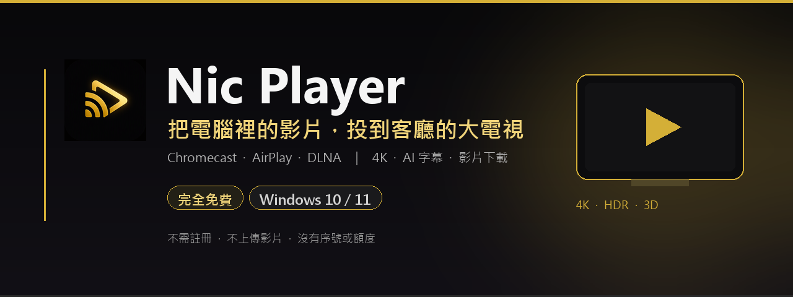
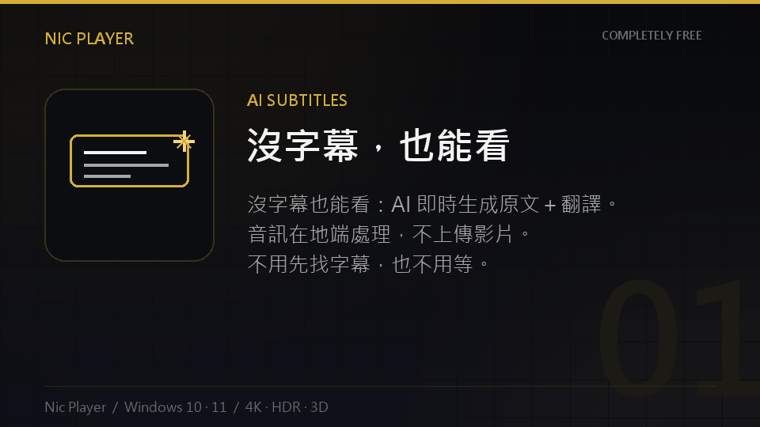
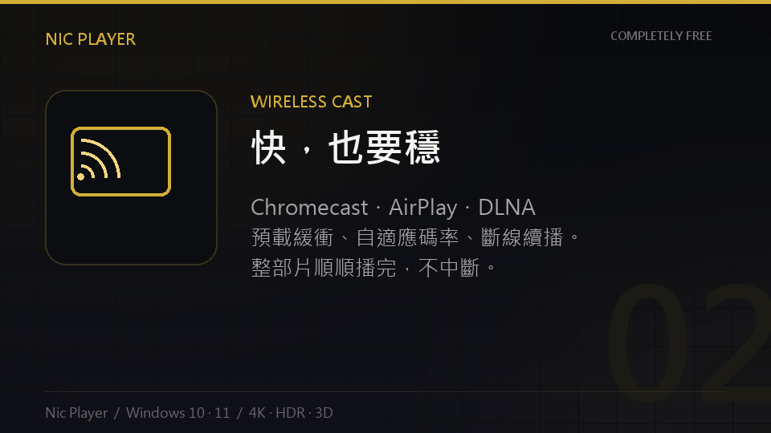
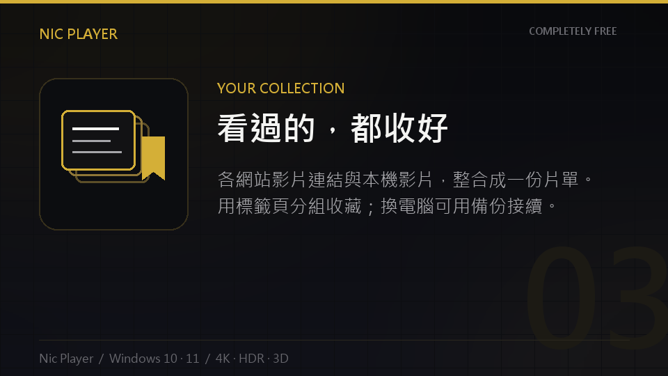
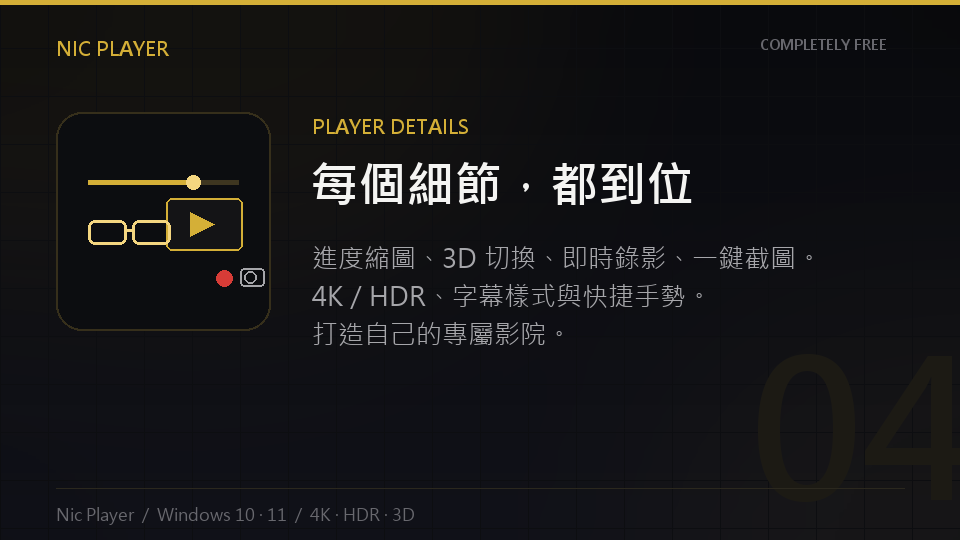

# Nic Player

  

  
  
  
  

<h1 align="center">把電腦裡的影片， 投到客廳的大電視。</h1>

  <b>Chromecast · AirPlay · DLNA　｜　4K · HDR · 3D　｜　AI 字幕 · 影片下載</b> 
  黑金質感介面　·　完全免費　·　不註冊　·　不上傳影片　·　沒有序號或額度

  
  

> **不是把畫面丟到電視，而是把整部電影，穩穩送達。**  
> 從本機影片、網頁影片到 YouTube，Nic Player 把「找片、播放、投放、收藏」收進同一個黑金質感的桌面影院。

---

## 四個最有感的功能

<table>
  <tr>
    <td width="50%" valign="top">
      
      
<b>01　沒字幕，也能看</b> 
      沒有字幕的影片，也能用 AI 即時生成原文＋翻譯字幕。音訊在地端處理，不上傳影片，也不必先找字幕檔。

    </td>
    <td width="50%" valign="top">
      
      
<b>02　無線投放，快也要穩</b> 
      Chromecast、AirPlay、DLNA 一次到位。預載緩衝、自適應碼率與斷線續播，讓整部片順順播完。

    </td>
  </tr>
  <tr>
    <td width="50%" valign="top">
      
      
<b>03　看過的，都收好</b> 
      把各網站影片連結與本機影片整合成一份播放紀錄。用標籤頁分組收藏，換電腦可用備份接續。

    </td>
    <td width="50%" valign="top">
      
      
<b>04　每個細節，都到位</b> 
      進度條即時縮圖、3D 格式切換、本機影片即時錄影、一鍵截圖；4K／HDR、字幕樣式與快捷手勢一次擁有。

    </td>
  </tr>
</table>

功能示意圖 · 實際介面以軟體版本為準

---

## AI 字幕：沒字幕，也能看

  

- **沒有字幕的影片，也能輕鬆生成字幕**：播放中按「AI 字幕」，邊看邊生成原文與台灣繁體中文翻譯。
- **原文／譯文自由切換**：雙語、僅譯文、僅原文，依觀看習慣選擇。
- **離線在地運算**：影片音訊不上傳；第一次使用時下載 AI 引擎與模型，之後即可重複使用。
- **字幕就是標準字幕軌**：延遲、字級、顏色、位置與 3D 每眼字幕同步支援。

> 適合外語片、紀錄片、老片、沒有字幕檔的收藏，以及只想「打開就看得懂」的晚上。

---

## 無線投放：快，也要穩

  

Nic Player 不是把畫面即時壓縮後硬丟到電視，而是先替你把路準備好：

- **Chromecast、AirPlay、DLNA 全支援**：Chromecast／Google TV、Apple TV／AirPlay 電視、各大品牌 DLNA 智慧電視。
- **投放前先測網路**：延遲、抖動、封包遺失先量一遍；不穩定時先預載，避免開頭卡頓。
- **預載緩衝＋自適應碼率**：先累積安全存量再開播，網速變慢時自動調整畫質。
- **斷線自動重連＋續播**：無線短暫中斷也不用手忙腳亂重新投放。
- **投放中照樣遙控**：播放／暫停、跳轉、電視音量、字幕大小，電腦端就能控制。

> 同一個 Wi-Fi、同一個客廳，Nic Player 幫你把「連線運氣」變成「穩定播放」。

---

## 播放紀錄：你的跨網站片單

  

- **本機影片＋網頁影片＋YouTube，一份紀錄**：看過什麼、看到哪裡，全部整合。
- **自訂標籤頁分類**：電影、影集、教學、待看⋯⋯同一筆可放進多個標籤頁。
- **接續播放／從頭播放／投放**：從上次位置繼續，或重新開始，不必自己記時間。
- **每部片記住自己的字幕選擇**：AI／官方 CC／本機字幕／無字幕，下次自動沿用。
- **匯出／匯入完整備份**：所有設定、全部播放紀錄與進度、標籤頁一起帶走；換電腦也能接續。
- **多個 Nic Player 共用紀錄**：同一台電腦開多個播放器，播放紀錄與進度同步。

> 你收藏的不是「連結」，而是「下一次打開就能繼續看」的體驗。

---

## 播放器：留給在意細節的人

  

### 進度條即時縮圖預覽
滑過進度條，先看該位置的畫面再決定跳不跳；本機、網頁、投放都支援。

### 3D 格式切換
紅藍、Half-SBS／Half-TAB、Full-SBS／Full-TAB；自動偵測或手動指定，並可交換左右眼、微調收斂與垂直對齊。

### 本機影片即時錄影
看到精彩片段，直接錄下；不必開另一個剪輯軟體。

### 一鍵截圖
無損 PNG，直接存到指定資料夾；看到喜歡的畫面，按一下就好。

### 還有這些
- **4K／HDR／8K 解碼**、硬體加速、ASS 特效字幕
- **全格式免解碼包**：MP4／MKV／AVI／FLV／WMV／HEVC／AV1／VP9
- **本機／網頁／YouTube 都能播**
- **迷你純影片模式**：縮到角落邊做事邊看
- **播放清單自動續播**、左右換片箭頭
- **黑金質感介面**，沒有廣告、沒有註冊、沒有額度

---

## 為什麼是 Nic Player？

| 一般投放工具 | Nic Player |
|---|---|
| 即時畫面傳送，網路一抖就卡 | 投放前測鏈路、預載緩衝、ABR、斷線續播 |
| 只能投特定格式 | 幾乎所有常見影片格式，自動選最佳播放方式 |
| 影片、字幕、紀錄散在不同程式 | 播放、投放、下載、收藏、備份一套完成 |
| 沒有字幕只能想辦法外掛 | AI 即時生成原文＋翻譯字幕 |
| 紀錄只有一個網址清單 | 跨網站片單＋標籤頁＋進度＋每片字幕記憶 |

> **完全免費、無廣告、不註冊。** 沒有序號、沒有使用時數、沒有下載次數限制；也沒有隱藏付費牆。

---

## 支援格式與裝置

| 類別 | 支援 |
|---|---|
| **投放** | Google Cast（Chromecast／Google TV／Android TV）、AirPlay／AirPlay 2（Apple TV 與支援電視）、DLNA／UPnP |
| **影片** | MP4／MKV／AVI／MOV／FLV／WMV／HEVC／AV1／VP9／HDR |
| **音訊** | AAC／MP3／FLAC／APE／WAV 等 |
| **字幕** | SRT／VTT／ASS／SSA、內嵌文字字幕、YouTube 官方 CC、AI 字幕、PGS／DVD 圖形字幕燒錄 |
| **系統** | Windows 10 22H2／Windows 11 x64 |

> 實際相容性依電視型號、網路環境與來源網站限制而異。DRM 保護內容不在支援範圍。

---

## 下載與安裝

  

1. 前往 **[最新版本下載頁](https://github.com/nickyvan101/nic-player-ai/releases/latest)**。
2. 下載 `NicPlayer-Setup-1.1.6-x64.exe`。
3. 執行安裝；未簽章版本可能出現 Windows SmartScreen「未知的發行者」，選擇「仍要執行」即可。
4. 第一次使用 AI 字幕時，軟體會引導下載 AI 引擎與模型。

> **系統需求**：Windows 10 22H2／Windows 11 x64。  
> **免費模式**：不需要帳號、不需要序號；所有功能免費開放。

---

## 文件與授權

- [使用說明](使用說明.md) — 完整操作、快捷鍵與常見問題
- [EULA](docs/EULA.txt) — 使用者授權合約
- [隱私政策](docs/PRIVACY.txt) — 資料處理與隱私說明
- [第三方授權](docs/licenses/README.md) — 開源元件與授權
- [原始碼要約](docs/licenses/SOURCE-OFFER.md) — GPL／LGPL 源碼取得方式
- [版本紀錄](https://github.com/nickyvan101/nic-player-ai/releases)

本專案不提供 DRM 破解，也不鼓勵侵害著作權。請只播放、備份與投放你有權使用的內容。

---

  <b>如果 Nic Player 讓你的客廳變得更像電影院，歡迎幫我們按一顆 ⭐ Star。</b> 
  Nic Player · Windows 10／11 · Chromecast · AirPlay · DLNA · 4K · AI 字幕

