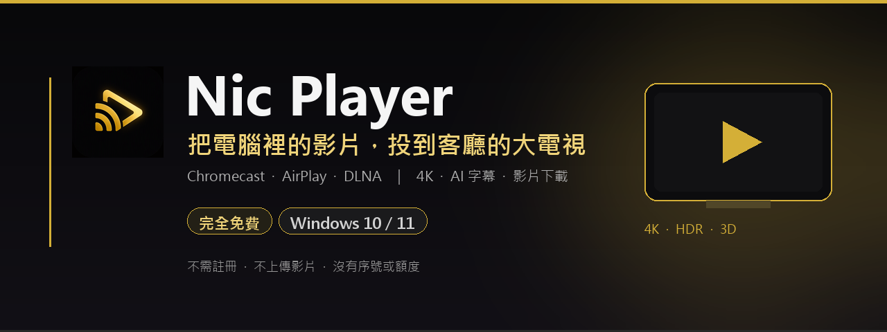

  
    
  
  
    
  
  
  
  

<h1 align="center">把電腦裡的影片，投到客廳的大電視</h1>

  <b>Nic Player</b> 是為 Windows 打造的桌面播放器：本地影片、網頁影片、Chromecast、AirPlay、DLNA，一次搞定。 
  <b>1.0.0</b>——完全免費無廣告，也不需要註冊帳號。

---

## 為什麼是 Nic Player？

| 🎬 一鍵投放 | 🤖 本機 AI 字幕 | ⬇️ 影片下載 | 🔒 隱私優先 |
|---|---|---|---|
| 選電視、按播放。Chromecast、AirPlay、DLNA 自動選最佳方式。 | Whisper＋Qwen 在你的電腦跑，邊看邊生成雙語字幕。 | 貼上連結就能存影片，最高 4K，也可只抓音訊。 | 影片與 AI 內容留在你的電腦；沒有帳號、沒有廣告、不上傳使用量。 |

## 功能亮點

- **三種投放協議，一台程式搞定**：Google Cast（Chromecast／Android TV／Google TV）、AirPlay／AirPlay 2、DLNA／UPnP。
- **不用自己轉檔**：自動判斷直連、Remux 或 HDR 色調映射轉碼；4K、HEVC、MKV、AVI、MOV 等格式直接播。
- **自適應碼率（ABR）＋預載**：網速變慢自動降畫質，盡量不卡頓；斷線後自動續播。
- **內建 mpv 播放器**：不投放也能在電腦上看；支援字幕、音量均衡、回看緩衝與電腦端 3D。
- **進度條縮圖預覽**：觀看影片時，滑鼠移動到進度條可即時查看縮圖預覽，輕鬆點選想要看的進度。
- **AI 字幕**：Whisper 語音辨識＋Qwen 翻譯，支援多語言、雙語字幕與時間軸微調；預設在本機執行。
- **影片下載器**：網路影片一鍵下載；可選畫質、字幕或只有音訊。
- **播放紀錄**：投放與電腦播放合併，同一部片接續看；標籤頁、批次整理、完整備份匯出／匯入。
- **完全免費**：所有功能開放，無廣告。

## 三步驟，開始看

1. **下載並安裝** Nic Player 1.0.0（Windows 10 22H2／11 x64）。
2. **加入影片**：拖進視窗、選擇本機檔案，或貼上網頁影片連結。
3. **選電視、按投放**；沒有電視也可以用內建播放器直接在電腦看。

> 第一次使用 AI 字幕時，程式會自動下載引擎與 VAD（GitHub），大型 Whisper／Qwen 模型維持從 Hugging Face 官方下載。需要網路與足夠磁碟空間。

---

## 下載 Nic Player 1.0.0

**Windows 10 22H2／Windows 11 x64**　·　約 264 MB　·　未簽章

SHA-256：`d8a6c313c107b3a055d017638c9c544acd0ccb0c23e7a626e4e6d160f4ca0eb0`

[Release Notes](https://github.com/nickyvan101/nic-player-ai/releases/tag/app-1.0.0)　·　[使用說明](使用說明.md)

> **SmartScreen 提醒**：1.0.0 是未簽章版本，Windows 可能顯示「未知的發行者」。這是因為目前沒有程式碼簽章憑證，不是病毒；可選擇「仍要執行」。下載後可用上方 SHA-256 核對檔案。

## 系統需求

| 項目 | 需求 |
|---|---|
| 作業系統 | Windows 10 22H2（build 19045+）／Windows 11 x64 |
| 記憶體 | 建議 8 GB 以上（AI 字幕建議 16 GB） |
| 顯示卡 | AI 可選 CPU；NVIDIA CUDA 加速需相容驅動 |
| 磁碟空間 | 主程式約 1 GB；AI 模型與引擎另計（數 GB） |
| 網路 | 網頁影片、投放、AI 首次下載需要；本地播放離線可用 |

## 常見問題

<b>真的完全免費嗎？需要序號嗎？</b>

 
是。1.0.0 起不需要序號、不需要付款，也沒有每日使用時數或下載次數限制。程式不會連線授權伺服器，也不會回傳使用量。

<b>需要註冊帳號嗎？</b>

 
不需要。下載、安裝、播放都不需要帳號。

<b>我的影片會上傳到哪裡嗎？</b>

 
不會。本機影片、音訊與 AI 字幕內容都在你的電腦處理；投放只在區網內進行。網頁影片仍會連線到原本的網站。

<b>為什麼 Windows 顯示「未知的發行者」？</b>

 
目前 installer 沒有 Authenticode 簽章。SHA-256 與 Release 頁面一致；若你要求簽章版，請等後續版本。

<b>AI 第一次使用為什麼要下載？</b>

 
AI 引擎與 VAD 較大，不隨 installer 打包；第一次使用時從 GitHub Release 下載並驗簽。Whisper／Qwen 大型模型則從 Hugging Face 官方來源下載，不經過本 repo。

<b>支援哪些電視？</b>

 
Google Cast（Chromecast、Android TV、Google TV）、AirPlay／AirPlay 2（Apple TV 與支援 AirPlay 的電視）、DLNA／UPnP（多數智慧電視）。實際支援仍依電視型號與網路環境而異。

---

## 授權、隱私與原始碼

- [EULA（1.0.0，完全免費）](docs/EULA.txt)
- [隱私政策（1.0.0）](docs/PRIVACY.txt)
- [第三方元件授權](docs/licenses/README.md)
- 原始碼：依 GPL／LGPL 要求可透過客服索取（不公開上傳 GitHub Releases）。
- [AI 引擎與必要元件 1.0.0](https://github.com/nickyvan101/nic-player-ai/releases/tag/ai-1.0.0)（主程式之外的 AI 元件）

> Nic Player 與 Google、Apple、Microsoft 無隸屬關係；Chromecast、AirPlay、DLNA 等名稱與商標屬各自權利人。影片下載與播放請遵守來源網站條款與著作權規定。

  Nic Player 1.0.0 · 2026-11-01 · Made for the couch.

